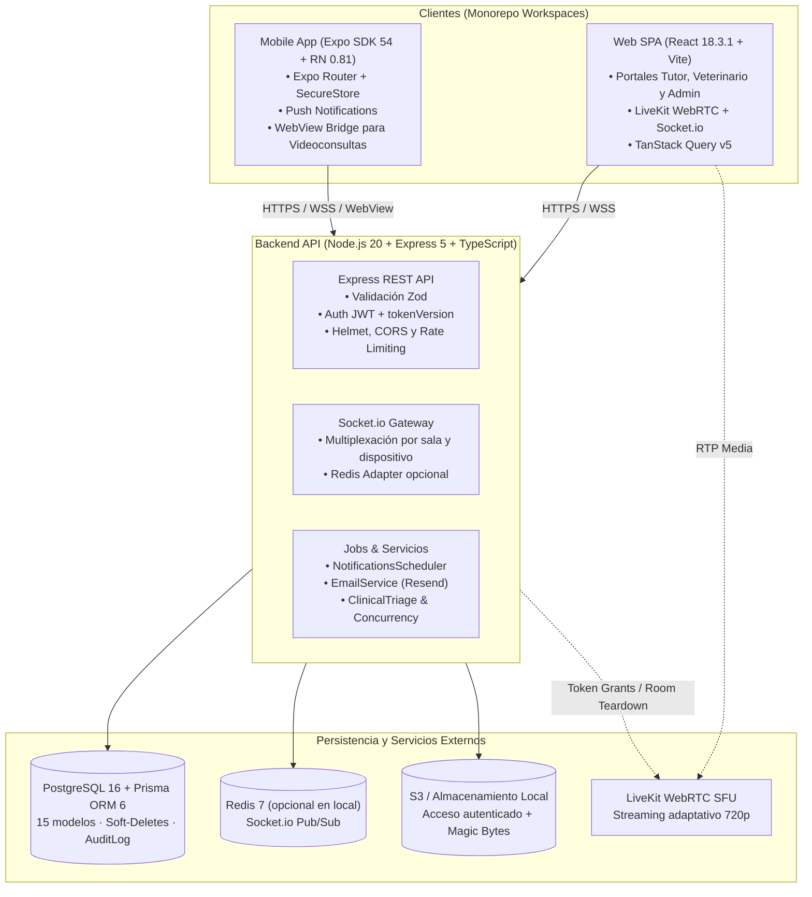

<div align="center">

# Huellicam
### *Plataforma Marca Blanca de Telemedicina Veterinaria y Gestión Clínica*

[](https://nodejs.org)
[](https://www.typescriptlang.org/)
[](https://react.dev)
[](https://expo.dev)
[](https://www.prisma.io)
[](https://livekit.io)

</div>

---

## Resumen Ejecutivo

**Huellicam** es una plataforma integral de telemedicina veterinaria pensada para operar tanto en clínicas individuales como en redes hospitalarias bajo esquema **marca blanca (white-label)**. Conecta a tutores de mascotas (`CLIENT`), médicos veterinarios matriculados (`VET`) y administradores (`ADMIN`) mediante triaje clínico automatizado, mensajería en tiempo real, videoconsultas WebRTC y emisión de recetas digitales verificables por código QR.

---

## Estado Actual de Implementación

El repositorio se estructura como un monorepo con tres workspaces (`backend`, `web`, `mobile`). La siguiente tabla resume qué capacidades están operativas en código y cuáles forman parte de la hoja de ruta:

| Área / Capacidad | Estado | Implementación Actual en Código |
|---|---|---|
| **Auth, Sesiones y Recuperación** | Implementado | JWT + refresh rotation (`tokenVersion`), cookie `HttpOnly` en web, `expo-secure-store` en mobile, OTP de 6 dígitos por email (`PasswordResetToken`) y cambio de contraseña autenticado (`PATCH /api/users/password`). |
| **Gestión de Mascotas e Historia Clínica** | Implementado | CRUD con soft-delete (`deletedAt`), peso, sexo, fecha de nacimiento (`birthDate`), microchip ISO (15 dígitos), alergias, condiciones crónicas y dossier imprimible. |
| **Triaje Clínico y Cola de Guardia** | Implementado | Motor determinista basado en reglas (`clinicalTriage.engine.ts`), cola `WAITING`, asignación atómica (`consultationConcurrency.service.ts` + `ConsultationAuditLog`), timeout de espera (15 min) y ventana de gracia por desconexión (3 min). |
| **Chat Clínico y Adjuntos** | Implementado | Socket.io con deduplicación por `clientMsgId`, sincronización incremental (`?after=`), carga multimedia con validación por *Magic Bytes* (JPEG/PNG/PDF, 10 MB/archivo, 50 MB/día) y descarga autenticada (`GET /api/media/:id`). |
| **Videoconsultas WebRTC (LiveKit)** | Implementado | Emisión de tokens sin PII (`calls.service.ts`), timbrado (`POST /api/calls/:consultationId/ring`), sala `<LiveKitRoom>` en web (`web/src/vet/CallRoom.tsx`) y puente WebView en mobile (`mobile/app/(app)/call/[consultationId].tsx`). |
| **Recetas Digitales y Verificación QR** | Implementado | Emisión por veterinario asignado, generación de URL pública con QR y verificación sin login (`GET /api/prescriptions/:id` y ruta `/prescriptions/:id` / `/verify-rx`). |
| **Notificaciones Push y Emails Automáticos** | Implementado | Bandeja in-app (`Notification`), despacho a Expo Push API (`PushToken`) y scheduler automático (`notifications.scheduler.ts`) con deduplicación (`EmailDispatchLog`) para recordatorios, controles cada 180 días y cumpleaños. |
| **Panel de Administración y Gobernanza** | Implementado | Aprobación/rechazo de matrículas (`PENDING -> APPROVED/REJECTED`), CRUD de usuarios y mascotas con restauración, inspección de consultas, `AuditLog`, *feature flags* operativos, métricas ejecutivas y configuración arancelaria base. |
| **App Mobile (Expo SDK 54)** | Implementado (Híbrido WebView) | Navegación Expo Router, autenticación segura, notificaciones push y ejecución de videollamadas mediante `react-native-webview` conectado a la web SPA. La migración a LiveKit nativo queda planificada como fase futura. |
| **Pasarela de Pagos Externa** | Roadmap / Diseño | Definición arquitectónica de `IPaymentGateway` y parámetros base en admin (`pricing-settings`, flag `PAYMENTS_ENABLED`); el procesamiento transaccional con PSP externo (Stripe / Mercado Pago / PagoFlex) no está conectado aún. |

---

## Arquitectura del Sistema



---

## Estructura del Repositorio

```text
.
├── backend/                # API REST (Express 5), Socket.io, Prisma ORM 6 y scheduler de emails
├── web/                    # SPA Web (React 18.3.1, Vite 6, Tailwind CSS v3, Storybook, Vitest)
├── mobile/                 # App móvil (Expo SDK 54, Expo Router, WebView bridge para llamadas)
├── docs/                   # Documentación técnica, arquitectura, contratos y compliance
├── scripts/                # Utilidades de assets Expo y verificación de consistencia documental
├── .github/workflows/      # Pipeline CI (typecheck, gobernanza, Jest, Vitest)
├── docker-compose.yml      # Servicios locales PostgreSQL 16 y Redis 7
├── vercel.json             # Configuración de build y rewrites SPA para Vercel
├── .env.example            # Plantilla de variables para entorno local
└── .env.production.example # Plantilla de variables para despliegue productivo
```

---

## Índice de Documentación

| Documento | Alcance | Enlace |
|---|---|---|
| **Arquitectura del Sistema** | Subsistemas, capas internas, estrategia híbrida móvil y decisiones estructurales. | [ARCHITECTURE.md](docs/ARCHITECTURE.md) |
| **Referencia Técnica** | Los 15 modelos de Prisma, endpoints REST reales, eventos Socket.io y tests. | [TECH_REFERENCE.md](docs/TECH_REFERENCE.md) |
| **Especificación Técnica** | Reglas de negocio, máquina de estados, triaje determinista, seguridad y SLOs. | [SPEC.md](docs/SPEC.md) |
| **Decisiones de Arquitectura** | Registro consolidado de ADRs (`ADR-001` a `ADR-032`). | [DECISIONS.md](docs/DECISIONS.md) |
| **Guía de Despliegue** | Infraestructura productiva (VPS/Coolify, Vercel, PostgreSQL, Redis, LiveKit, Expo). | [DEPLOY.md](docs/DEPLOY.md) |
| **Marco Legal y Compliance** | Ley 25.326, Ley 14.072, SENASA Res. 1442/2021, Ley 24.240 y WCAG 2.1 AA. | [MARCO_LEGAL_COMPLIANCE_Y_AUDITORIA.md](docs/MARCO_LEGAL_COMPLIANCE_Y_AUDITORIA.md) |
| **Documentación Web** | Enrutamiento SPA, portales, manejo de sesión, Storybook y suite Vitest. | [docs/web/README.md](docs/web/README.md) |
| **Documentación Mobile** | Arquitectura actual sobre WebView, puente nativo, permisos y roadmap nativo. | [docs/mobile/README.md](docs/mobile/README.md) |
| **Pagos Marca Blanca** | Estado actual vs diseño modular (`IPaymentGateway`) y alternativa local PagoFlex. | [docs/payments/README.md](docs/payments/README.md) |

---

## Requisitos Previos y Arranque Local

| Requisito | Versión Mínima | Uso |
|---|---|---|
| **Node.js** | `>= 20.x LTS` | Runtime del monorepo |
| **npm** | `>= 10.x` | Gestión de workspaces |
| **Docker & Docker Compose** | Reciente | PostgreSQL 16 y Redis 7 locales |
| **Expo Go / Android SDK** | SDK 54 / JDK 21 | Desarrollo y build móvil |

```bash
# 1. Levantar PostgreSQL y Redis locales
docker compose up -d

# 2. Instalar dependencias del monorepo
npm install

# 3. Configurar variables de entorno
cp .env.example backend/.env

# 4. Aplicar migraciones y cargar datos iniciales
cd backend && npx prisma migrate deploy && npm run seed && cd ..

# 5. Iniciar Backend (puerto 3001) y Web (puerto 5173)
npm run dev

# 6. Iniciar Mobile bundler (en otra terminal)
npm run dev:mobile
```

En Windows también están disponibles los scripts [run.bat](run.bat) y [start.ps1](start.ps1) (con `adb reverse` automático para pruebas por USB).

---

## Scripts de Calidad y Verificación

```bash
# Verificar consistencia entre schema.prisma y documentación
npm run check:governance

# Typecheck estricto de TypeScript en los 3 workspaces
npm run typecheck

# Ejecutar pruebas en todo el monorepo (Jest en backend/mobile, Vitest en web)
npm test

# Build de producción (backend + web)
npm run build

# Pipeline completo pre-despliegue
npm run verify:predeploy
```

---

## Equipo de Desarrollo

- **Tobias Vera** — *Tech Lead & Backend Developer*
- **Juan Mendoza** — *Mobile Lead Developer*
- **Damian Orellana** — *Web Frontend Developer & UI/UX*
- **Ezequiel Charca** — *QA Automation Engineer & Product Designer*

*Huellicam — Grupo Pinnacle 2026.*
