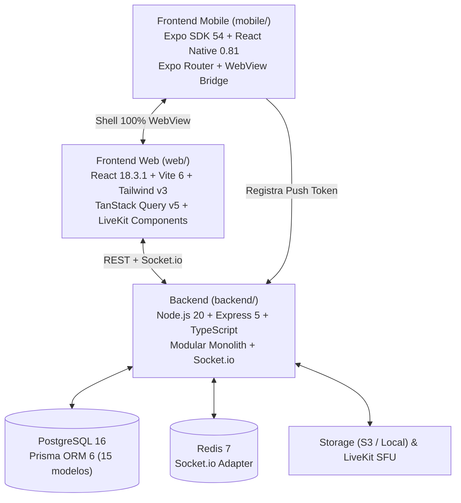

# Arquitectura del Sistema — Huellicam

Este documento describe la organización técnica de **Huellicam**, sus subsistemas desacoplados, las responsabilidades por capa y las decisiones estructurales vigentes en el código.

---

## 1. Visión de Subsistemas

El monorepo centraliza tres clientes/servicios principales bajo `npm workspaces`, compartiendo contratos mediante esquemas Zod y tipos TypeScript sincronizados:

---

## 2. Backend (`backend/`) — Monolito Modular

El servidor HTTP (`Express 5`) y el gateway en tiempo real (`Socket.io`) se ejecutan en un mismo proceso (`backend/src/server.ts`), organizados por módulos de dominio:

| Capa / Directorio | Responsabilidad |
|---|---|
| `src/app.ts` | Configuración de middlewares globales (`helmet` CSP, `cors` dinámico, `cookie-parser`, `express-rate-limit`), montaje de rutas `/api/*`, `/health` y `errorHandler`. |
| `src/server.ts` | Arranque HTTP + Socket.io, auto-verificación de esquema en arranque (`ensureDatabaseSchema`), inicio de `NotificationsScheduler` y *graceful shutdown* (`SIGTERM`/`SIGINT`). |
| `src/config/` | Validación *fail-fast* de variables de entorno con Zod (`env.ts`) y lista blanca dinámica de orígenes CORS (`cors.ts`). |
| `src/lib/` | Cliente singleton de Prisma (`prisma.ts`) con manejo de pool de conexiones. |
| `src/modules/auth/` | Registro, login, rotación de refresh tokens (`tokenVersion`), cookies `HttpOnly` / tokens mobile y recuperación de contraseña por código de 6 dígitos (`passwordReset.service.ts`). |
| `src/modules/users/` | Actualización de perfil (`isOnline`, `bio`, `phone`, `photoUrl`) y cambio de contraseña autenticado (`PATCH /api/users/password`). |
| `src/modules/pets/` | CRUD de mascotas con soft-delete, datos fisiológicos/clínicos (`birthDate`, microchip ISO, alergias, patologías crónicas) y registro de documentos clínicos. |
| `src/modules/consultations/` | Flujo completo de consultas (4 estados canónicos), motor determinista de triaje (`clinicalTriage.engine.ts`), handoff multi-dispositivo con CAS (`consultations.service.ts` + `ConsultationAuditLog`), mensajería y reseñas. |
| `src/modules/calls/` | Generación de tokens JWT efímeros LiveKit (sin PII), timbrado en tiempo real (`ringCall`) y cierre de salas SFU (`deleteLiveKitRoom`). |
| `src/modules/prescriptions/` | Emisión de recetas digitales, generación de URL pública para código QR y consulta pública sin autenticación. |
| `src/modules/media/` | Subida multipart con almacenamiento temporal en disco, inspección de *Magic Bytes* (JPEG/PNG/PDF), control de cuota diaria (`DailyUploadCounter`) y streaming protegido o URL firmada S3. |
| `src/modules/notifications/` | Bandeja persistida de notificaciones, emisión vía Socket.io y despacho remoto vía Expo Push API. |
| `src/modules/admin/` | Validación de matrículas SENASA, CRUD completo de usuarios y mascotas, inspección de mensajes, revocación de sesiones, *AuditLog*, *feature flags*, métricas ejecutivas y tarifas base. |
| `src/realtime/` | Autenticación de sockets (`socket.auth.middleware.ts`), presencia distribuida en Redis (`presence.service.ts`), deadlines ZSET (`vetDisconnectTracker.ts`), expulsión unificada (`sessionEviction.helper.ts`), salas y gateway (`chat.gateway.ts`). |
| `src/services/` & `src/jobs/` | Despacho de correos vía Resend (`email.service.ts`) y scheduler horario con deduplicación persistida (`notifications.scheduler.ts`). |

---

## 3. Frontend Web (`web/`)

Aplicación SPA construida con **React 18.3.1 (LTS)** y **Vite 6**, optimizada con *code-splitting* por ruta (`React.lazy` + `Suspense`) y hojas de estilo aisladas por portal (`ScopedStyle`):

- **Portal Público y Auth:** `Landing.tsx`, `AuthExperience.tsx`, `PrescriptionView.tsx` y páginas legales (`/privacy`, `/terms`, `/cookies`, `/refunds`).
- **Portal del Tutor (`/client/*`):** `ClientApp.tsx` (y componentes de soporte como `ClinicalIntakeForm.tsx`) para gestión de mascotas, intake clínico guiado, historial, mensajes y recetas.
- **Consola Veterinaria (`/vet/*`):** `vet/VetApp.tsx` + `vet/vetkit.tsx` con disponibilidad de guardia, cola priorizada por triaje en vivo (`Socket.io` + polling reactivo), ficha de pacientes, mensajería y emisión de recetas.
- **Sala de Videoconsulta (`/call/:id`):** `vet/CallRoom.tsx` integra LiveKit WebRTC (`<LiveKitRoom>` / `<VideoConference />`), chat clínico (`ClinicalChatThread.tsx`) y puente `window.ReactNativeWebView` para la app móvil.
- **Consola Administrativa (`/admin/*`):** `AdminApp.tsx`, `AdminExecutiveMetrics.tsx` y `AdminFeatureFlagsModal.tsx`.
- **Sincronización y Resiliencia HTTP:** `services/api.ts` implementa cola de refresco único (`failedQueue`) ante respuestas `401` concurrentes y escucha eventos de revocación de sesión (`SESSION_REVOKED`).

---

## 4. Aplicación Mobile (`mobile/`) — Shell 100% WebView

La aplicación móvil está construida con **Expo SDK 54**, **React Native 0.81.4** y **Expo Router**:

- **Estrategia Vigente (Shell 100% WebView sobre `web/`):** Toda la interfaz funcional (autenticación, portales Tutor y Veterinario, triaje, chat, videollamadas LiveKit y recetas) corre dentro de `mobile/app/index.tsx` embebiendo la Web App responsive (`EXPO_PUBLIC_WEB_URL`) vía `react-native-webview`. Si inicia sesión un `ADMIN`, la app muestra un aviso para utilizar la versión web de escritorio.
- **Puente Bidireccional (`web/src/lib/mobileBridge.ts` ↔ `mobile/src/lib/webviewBridge.ts`):** Coordina sincronización de sesión hacia nativo (`auth:session` / `auth:logout`) para registro de tokens Push, prevención de suspensión durante llamadas (`wakelock:acquire` / `release`, `call:ended`), impresión/PDF nativo (`print:request`), enlaces externos (`external:open`) y navegación desde notificaciones o deep links (`huellicam:navigate`).
- **Capacidades Nativas del Contenedor:** Splash screen, detección Offline (`NetInfo`), botón físico Atrás (`BackHandler`), permisos de cámara/micrófono (`expo-camera`), WakeLock (`expo-keep-awake`) y notificaciones push (`expo-notifications`).
- **Aislamiento en Monorepo (`metro.config.js`):** Dado que `web/` usa React 18.3.1 (compatibilidad con LiveKit Web) y `mobile/` usa React 19.1.0, Metro fuerza la resolución singleton hacia `mobile/node_modules/react` y `react-native`.
- **Evolución Futura:** La reimplementación de vistas nativas idénticas a la web (incluyendo SDK LiveKit nativo) queda planificada como fase posterior cuando se requiera separar la experiencia móvil del WebView.

---

## 5. Estrategia de Datos y Tipos Compartidos

Se evita la complejidad de empaquetado cruzado (`packages/shared`) entre Vite y Metro. Los esquemas de validación y DTOs se definen en `backend/src/modules/*/*.schemas.ts` con **Zod** y el modelo canónico reside en `backend/prisma/schema.prisma`; ambos clientes (`web/src/types/` y `mobile/src/types/`) mantienen interfaces TypeScript sincronizadas con esos contratos.

---

## 6. Alcance Implementado vs. Hoja de Ruta

| Capacidad | Estado Actual | Detalle |
|---|---|---|
| Núcleo clínico (Auth, Mascotas, Triaje, Chat, Video, Recetas QR, Admin) | **Operativo** | Implementado de punta a punta entre `backend/`, `web/` y `mobile/`. |
| Configuración arancelaria y métricas ejecutivas | **Operativo (en memoria + AuditLog)** | Endpoints `/api/admin/pricing-settings` y `/api/admin/executive-metrics` listos; persistencia actual en memoria de proceso y auditoría en `AuditLog`. |
| Feature Flags administrativos | **Operativo (en memoria + AuditLog)** | `PAYMENTS_ENABLED`, `TRIAGE_ACTIVE`, `VIDEOCALLS_ENABLED`, `NEW_REGISTRATIONS_ENABLED`. |
| Cobro real con pasarela externa (`IPaymentGateway`) | **Planificado (no conectado)** | Documentado en [docs/payments/README.md](payments/README.md) para activación en fase comercial. |
| App nativa completa en Mobile (sin WebView) | **Planificado (pendiente)** | Actualmente toda la app móvil opera como shell 100% WebView sobre `web/`. |
