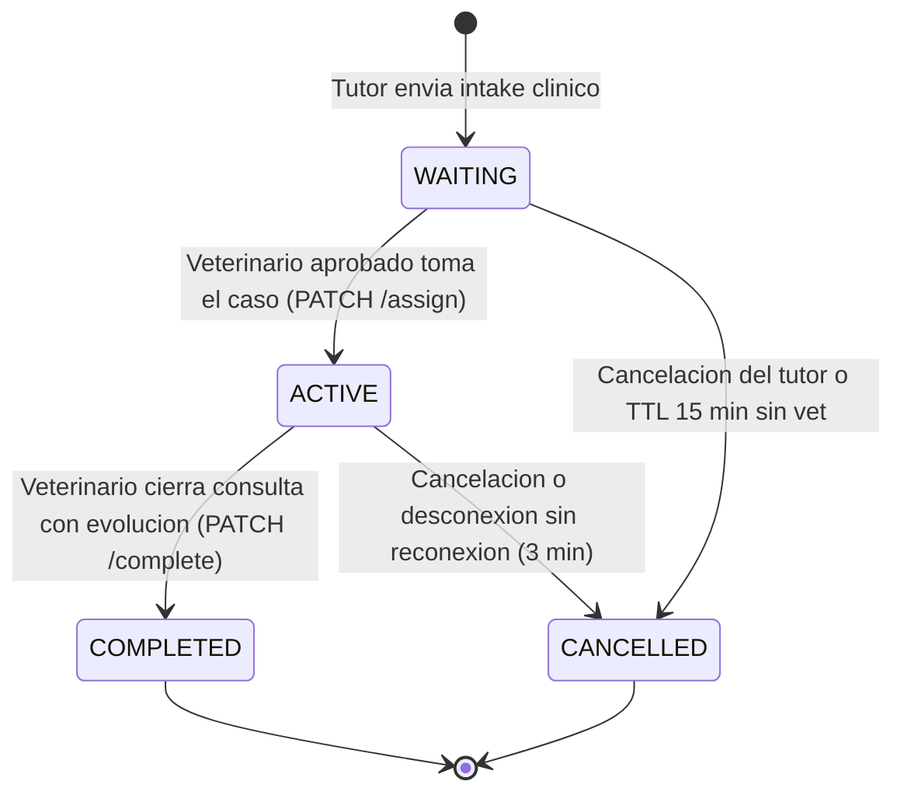

# Especificación Técnica y Funcional (SPEC) — Huellicam

Especificación consolidada del comportamiento funcional, máquina de estados, seguridad, requerimientos no funcionales y hoja de ruta de **Huellicam**.

---

## 1. Objetivos y Alcance del Sistema

Huellicam digitaliza la atención veterinaria a distancia con trazabilidad clínica, separación estricta de roles y minimización de datos personales:

1. **Admisión y Triaje Clínico Determinista:** Evaluación automática de severidad sin depender de que el tutor elija manualmente un color de urgencia.
2. **Guardia y Concurrencia Segura:** Asignación atómica de consultas evitando doble toma y tolerando reconexiones multidispositivo.
3. **Comunicación Multimodal:** Chat en tiempo real con adjuntos validados + videollamada WebRTC HD (720p adaptativa) sin exposición de PII en tokens de media.
4. **Prescripción Verificable:** Emisión de recetas digitales con código QR de verificación pública.
5. **Trazabilidad y Cumplimiento:** Soft-deletes legales, auditoría administrativa (`AuditLog`) y auditoría granular de consultas (`ConsultationAuditLog`).

---

## 2. Roles y Control de Acceso

| Rol | Capacidades Principales | Restricciones de Seguridad |
|---|---|---|
| `CLIENT` | Gestiona sus mascotas, solicita consultas de urgencia/orientación, participa en chat y videollamada, visualiza recetas y califica consultas finalizadas. | Solo accede a sus propias mascotas y consultas. No puede editar evoluciones médicas ni emitir recetas. |
| `VET` | Gestiona su estado de guardia (`isOnline`), revisa la cola priorizada, toma consultas (`assign`), chatea, realiza videollamadas, completa evolución médica y emite recetas. | Requiere `vetStatus = APPROVED` en producción para atender consultas (`PENDING` / `REJECTED` quedan bloqueados). |
| `ADMIN` | Verifica matrículas profesionales (`PENDING -> APPROVED/REJECTED`), administra usuarios/mascotas, inspecciona consultas, gestiona *feature flags*, tarifas y métricas. | Toda acción crítica genera registro en `AuditLog`. |

---

## 3. Flujos Críticos y Máquina de Estados

### 3.1 Ciclo de Vida de la Consulta

Además de los 4 estados principales (`WAITING`, `ACTIVE`, `COMPLETED`, `CANCELLED`), el enum `ConsultationStatus` contempla estados extendidos (`TRIAGE_CRITICAL_QUEUED`, `CLAIM_PENDING_SYNC`, `LIVEKIT_CONNECTING`, `IN_CALL_ACTIVE`, `AWAITING_EMERGENCY_CALLBACK`, `HANDOFF_IN_PROGRESS`) y la tabla `ConsultationAuditLog` junto con `stateVersion`, `activeDeviceId` y `transportStatus` para soportar reclamos con bloqueo de fila (`FOR UPDATE`) y recuperación de sesión entre dispositivos en `consultationConcurrency.service.ts`.

**Reglas de timeout implementadas:**
- **Espera máxima en cola (`checkTriageTimeout`):** Si una consulta permanece en `WAITING` más de **15 minutos**, transiciona automáticamente a `CANCELLED` añadiendo `[CANCELLED_TIMEOUT_NO_VET_AVAILABLE]` y cerrando la sala LiveKit si existiera.
- **Desconexión en consulta activa (`checkVetDisconnectTimeout`):** Ventana de gracia de **3 minutos** ante desconexión prolongada (`[VET_DISCONNECTED_TIMEOUT]`).

### 3.2 Motor Determinista de Triaje Clínico (`clinicalTriage.engine.ts`)

Inspirado en criterios de *Veterinary Triage Index (VTI)* y *Manchester Triage System (MTS)*:
- El tutor envía mascota, lista de síntomas observables (`symptoms`), ventana temporal (`duration`: `LESS_THAN_2_HOURS`, `HOURS_2_TO_12`, `DAYS_1_TO_2`, `MORE_THAN_2_DAYS`) y relato libre (`notes`).
- El backend evalúa de forma determinista palabras clave críticas, signos vitales comprometidos, vulnerabilidad por raza (ej. cuadros respiratorios en razas braquicéfalas) y tiempo de evolución.
- Calcula severidad (`ROJO`, `AMARILLO`, `VERDE`), puntaje numérico (`1..10`), bandera `isEmergency` y `redFlags`, formateando un resumen estructurado para el veterinario. En la interfaz del tutor se ocultan las etiquetas técnicas internas (`parseConsultationNotes`).

### 3.3 Ficha Declarativa vs. Expediente Clínico Inmutable

- **Ficha Declarativa (`Pet`):** Editable por el tutor (`name`, `species`, `breed`, `weightKg`, `sex`, `birthDate`, `microchip`, `allergies`, `chronicConditions`).
- **Expediente Clínico (`Consultation`, `diagnosisNotes`, `Prescription`):** Registro clínico inmutable para el tutor; solo los profesionales autorizados agregan evoluciones y prescripciones.

---

## 4. Seguridad, Criptografía y Privacidad

1. **Autenticación y Revocación Atómica (`tokenVersion`):**
   - Access tokens JWT de corta duración (`15m`) y refresh tokens (`7d`).
   - En Web, el access token se mantiene en memoria y el refresh token viaja en cookie `HttpOnly; SameSite; Secure` (adaptada para desarrollo local o cross-domain productivo).
   - En Mobile, con el header `X-Client-Platform: mobile`, el refresh token se entrega en JSON y se guarda en `expo-secure-store`.
   - Cualquier logout, cambio/reset de contraseña o suspensión administrativa incrementa `User.tokenVersion`, invalidando tokens previos sin depender de listas negras en memoria.
2. **Validación Binaria de Archivos y Cuotas:**
   - Upload multipart mediante almacenamiento temporal en disco (`uploads/tmp/`) para evitar agotamiento de heap.
   - Verificación estricta de *Magic Bytes* para JPEG (`FF D8 FF`), PNG (`89 50 4E 47`) y PDF (`25 50 44 46`).
   - Límites aplicados: **10 MB** máximo por archivo (`413`) y **50 MB/día** acumulados por usuario en `DailyUploadCounter` (`429`).
   - Prohibición de servir el directorio de subidas de forma estática pública: todo acceso pasa por `GET /api/media/:id` con verificación de propiedad/participación.
3. **Cero PII en WebRTC:** Los tokens JWT de LiveKit incluyen únicamente un identificador técnico (`user.id` o `tutor_<userId>:<deviceId>`) y `user.firstName`; nunca correos, teléfonos ni matrículas.
4. **Soft-Deletes y Anonimización:** Las bajas preservan el historial clínico médico-legal marcando `deletedAt` y desvinculando datos de contacto en bajas de cuenta.

---

## 5. Automatización de Correos (`NotificationsScheduler`)

El proceso `backend/src/jobs/notifications.scheduler.ts` se ejecuta cada hora (habilitado por defecto en `production`, opcional en desarrollo con `ENABLE_EMAIL_SCHEDULER=true`) y registra cada envío en `EmailDispatchLog` (`dedupeKey` único) para garantizar idempotencia:
- **Recordatorio de consulta (`APPOINTMENT`):** Máximo 1 correo por consulta `WAITING` creada en las últimas 24 horas.
- **Chequeo preventivo (`CHECKUP`):** Máximo 1 recordatorio cada 180 días para mascotas con ≥ 6 meses desde su alta y sin consultas recientes.
- **Saludo de cumpleaños (`BIRTHDAY`):** Máximo 1 envío anual cuando `Pet.birthDate` coincide con la fecha UTC actual (contemplando años no bisiestos para el 29 de febrero).

---

## 6. Requerimientos No Funcionales y Resiliencia

| Categoría | Objetivo / Mecanismo |
|---|---|
| **Consistencia de Chat** | Deduplicación obligatoria por `clientMsgId` único en PostgreSQL y reconciliación incremental vía `GET /api/consultations/:id/messages?after=`. |
| **Fallback de Infraestructura** | Si Redis no está disponible en desarrollo, Socket.io opera automáticamente en modo `InMemoryAdapter`. Si S3 no está configurado (`STORAGE_DRIVER=local`), almacena de forma segura en disco local. Si `RESEND_API_KEY` no está presente en desarrollo, los correos se registran en consola sin romper flujos. |
| **Graceful Shutdown** | Ante `SIGTERM`/`SIGINT`, el servidor cierra nuevas conexiones HTTP, desconecta Socket.io y libera conexiones Prisma antes de finalizar (timeout máximo 10s). |
| **Accesibilidad Web** | Contraste WCAG 2.1 AA, landmarks semánticos, navegación por teclado y banner de consentimiento de cookies accesible. |

---

## 7. Extensión Futura (Fuera del Alcance Actual)

Las siguientes capacidades están contempladas en la evolución del producto pero **no están implementadas** en la versión actual del repositorio:
- Integración de pasarela transaccional real bajo la interfaz `IPaymentGateway` (hoy existen métricas proyectadas y settings arancelarios en Admin).
- Modelo dedicado de libreta de vacunación (`VaccinationRecord`), agenda periódica de medicación (`MedicationSchedule`) y veterinarios favoritos (`FavoriteVet`).
- Reimplementación nativa completa en la app móvil (idéntica a la web y con SDK nativo de LiveKit) para reemplazar el shell actual 100% WebView.
- Sincronización iCal/Google Calendar y consulta automática de matrículas contra APIs externas.
