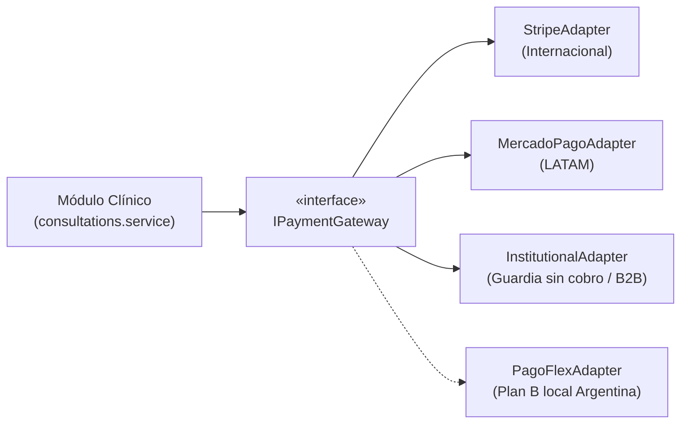

# Arquitectura de Pagos Marca Blanca — Huellicam

Documentación del estado actual y diseño modular de monetización para **Huellicam** como plataforma licenciable (**White-Label**).

---

## 1. Estado Real en el Código

Es importante distinguir lo que ya existe en el repositorio frente a lo que está planificado para la integración comercial:

| Componente | Estado | Ubicación / Evidencia |
|---|---|---|
| **Configuración de Arancel Base y Take-Rate** | **Implementado** | `GET /api/admin/pricing-settings` y `PATCH /api/admin/pricing-settings` en `backend/src/modules/admin/` + editor en `AdminExecutiveMetrics.tsx` (`baseConsultationFee`, `platformTakeRate`, moneda `ARS \| USD \| BRL \| MXN \| EUR`, auditado en `AuditLog`). |
| **Métricas Ejecutivas Proyectadas** | **Implementado** | `GET /api/admin/executive-metrics` calcula GMV proyectado, comisión neta, pérdida estimada por cancelaciones y tasa de conversión sobre consultas. |
| **Feature Flag Operativo (`PAYMENTS_ENABLED`)** | **Implementado** | `FeatureFlagsService` (`GET / PATCH /api/admin/feature-flags`). |
| **Pasarela Transaccional Real (`IPaymentGateway`)** | **Diseño / Roadmap** | No hay adaptadores de cobro ni webhooks conectados todavía a Stripe, Mercado Pago o PagoFlex. Las consultas hoy operan en modalidad de guardia sin cobro bloqueante. |

---

## 2. Diseño Objetivo: Patrón Adaptador (`Plan A — Marca Blanca`)

Para mantener el núcleo clínico exportable a distintos países y clientes B2B (clínicas, redes hospitalarias, aseguradoras), las reglas médicas en `consultations` no deben acoplarse a un procesador financiero específico. Toda operación futura se abstrae tras una interfaz común (`IPaymentGateway`):

### Contrato Previsto (`IPaymentGateway`)
- `createHold(params)` — Preautorización/retención temporal al confirmar el triage (`WAITING`).
- `capturePayment(transactionId)` — Captura definitiva al tomar/completar la consulta (`ACTIVE` / `COMPLETED`).
- `releaseHold(transactionId, reason)` — Liberación sin cargo ante cancelación previa o timeout de guardia (15 min).
- `refundPayment(transactionId, amount?)` — Reembolso ante fallas técnicas o auditoría.
- `handleWebhook(rawPayload, signatureHeader)` — Procesamiento idempotente de eventos asíncronos del PSP.

---

## 3. Alternativa Local Evaluada (`Plan B — PagoFlex Argentina`)

En caso de operar una instancia directa en Argentina canalizando liquidaciones veterinarias vía **PagoFlex**:
- Se implementaría únicamente como un adaptador aislado (`PagoFlexAdapter`) dentro de la misma interfaz `IPaymentGateway`, sin acoplar el core ni el esquema clínico a billeteras locales ni reglas impositivas específicas de una única jurisdicción.
- Mientras no exista definición comercial de activar cobros en vivo, la plataforma opera limpiamente bajo el modo institucional actual con parámetros configurables desde el panel de Administración.
